# Explainable Text-Guided Person Re-Identification across Cameras (CLIP + VLM)

> · Computer Vision · Person Re-ID, vision-language models, explainability
> Author: *[Nimra]*  · Platform: Google Colab (free Tesla T4)

**One-line idea.** In forensic work there is often no photo of the suspect, only a witness statement ("red jacket, black backpack").
This project builds a pipeline that searches a multi-camera gallery with an **image query, a text description, or both**, filters matches by **camera/time plausibility**, produces a **camera route**, and asks a **small VLM (SmolVLM) to explain the match** — and, importantly, *tests whether that explanation can be trusted* with a control experiment.

> ⚠️ **Research use only.** This is an academic study on a public benchmark. It must not be used or demonstrated for tracking real people (see [Ethics](#ethics-and-data-license)).

---

## TL;DR - what was found

| # | Finding | Key number |
|---|---|---|
| 1 | Re-ID fine-tuning is essential. | OSNet Rank-1 **14.5 → 91.8**, mAP **4.4 → 80.2** |
| 2 | In my T4-budget setup, a partially fine-tuned CLIP ViT-B/32 did **not** beat fine-tuned OSNet. | Rank-1 83.6 vs 91.8, mAP 66.0 vs 80.2 |
| 3 | Text-only retrieval from attribute sentences is far above chance but practically weak. | Rank-1 **1.7%**, mAP **1.3%** (random ≈ 0.07%) |
| 4 | Fusing the weak text score with image score gave **no reliable gain**; the best fixed weight (w=0.7) helped Rank-k slightly on blurred/low-res queries only. | Blur Rank-1 +3.1 pp, mAP +1.0 pp |
| 5 | My **sharpness-based adaptive weight was worse than image-only** in every condition, because the text branch is too weak to take weight from the image. | mAP −6.5 to −27.3 pp |
| 6 | The time-consistency filter changed metrics by ≤ 0.2 pp, and min-travel-time rules removed real matches (Market-1501 positives often appear nearly simultaneously across cameras). | up to 1.35% of true matches removed |
| 7 | SmolVLM almost never says "same" - **even for true matches** (0/50). The expected "VLM says yes to everything" bias was *not* observed; the opposite was. | positives 0%, hard negatives 2%, random negatives 0% |
| 8 | VLM clothing descriptions match ground-truth attributes only partially. | top 76.7%, bottom 64.3% |

These are honest, single-run numbers from one Colab session. Paper-level numbers were **not** reproduced and I did not try to match them.

---

## Pipeline

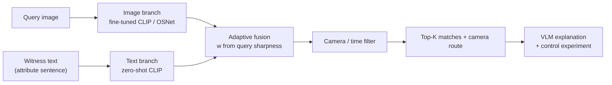

| Stage | What it does |
|---|---|
| 0 | Data: Market-1501 (6 cameras) + attribute annotations |
| 1 | Baseline: OSNet with ImageNet weights, no Re-ID training |
| 2a | Fine-tune OSNet (ID loss + batch-hard triplet loss) |
| 2b | Fine-tune CLIP ViT-B/32 image encoder (last 4 blocks + BNNeck head) |
| 3 | Text branch: attributes → English sentence → zero-shot CLIP text encoder |
| 4 | Fusion: `final = w·image + (1−w)·text`, `w` from query sharpness; test on degraded queries |
| 5 | Camera-topology/time filter + route construction |
| 6 | SmolVLM explanation + control experiment (positive / hard-negative / random pairs) |
| 7 | Gradio demo (code in the project; not part of the reported results, see below) |

---

## Research questions (and short answers)

| RQ | Question | Short answer | Figures |
|---|---|---|---|
| **RQ1** | How much does Re-ID-specific fine-tuning improve over an off-the-shelf pretrained backbone? | A lot: +77 pp Rank-1 (OSNet), +76 pp (CLIP). | [03](results/03_training_curves.png), [04](results/04_reid_comparison.png) |
| **RQ2** | Under a free-T4 budget, can a partially fine-tuned CLIP ViT-B/32 beat a fine-tuned OSNet? | No (−8.2 pp Rank-1, −14.1 pp mAP). | [04](results/04_reid_comparison.png) |
| **RQ3** | How far can a witness-style text description alone get retrieval (zero-shot CLIP)? | Much better than chance, but weak: 1.7% Rank-1. | [02](results/02_attribute_sentence_sanity.png), [05](results/05_text_vs_image_retrieval.png) |
| **RQ4** | Does fusing image and text scores help, especially for degraded queries? | Not reliably. Small Rank-k gain at w=0.7 on blur/low-res, nothing in mAP. | [06](results/06_fusion_ablation.png) |
| **RQ5** | Does a quality-driven adaptive weight beat fixed weights / image-only? | No - it was worse in all four conditions. | [06](results/06_fusion_ablation.png), [07](results/07_sharpness_and_adaptive_weight.png) |
| **RQ6** | Does a camera-topology/time-consistency filter improve retrieval, and how many true matches does it remove? | Negligible effect (≤ 0.2 pp); min-travel rules removed 0.6-1.4% of true matches. | [08](results/08_temporal_filter_effect.png), [09](results/09_camera_topology.png) |
| **RQ7** | Can the filtered matches be turned into a plausible camera route? | Mechanism works; with weak scores the examples were mostly wrong (1/16 steps correct). | [10](results/10_route_examples.png) |
| **RQ8** | Can the VLM reliably verify identity, or does it say "same" to everything (especially for hard negatives)? | Neither: it says "different" almost always (0/50 on true matches). | [11](results/11_vlm_control.png), [12](results/12_vlm_failure_case.png) |
| **RQ9** | Are the VLM's clothing descriptions faithful to ground-truth attributes? | Partly: top colour 76.7%, bottom colour 64.3%. | [13](results/13_vlm_explanation_accuracy.png) |

---

## Repository structure

```
.
├── README.md
├── notebooks/
│   └── person_re_identification_across_cameras.ipynb   # full Colab pipeline with saved outputs
└── results/
    ├── 01_dataset_sanity_check.png
    ├── 02_attribute_sentence_sanity.png
    ├── 03_training_curves.png
    ├── 04_reid_comparison.png
    ├── 05_text_vs_image_retrieval.png
    ├── 06_fusion_ablation.png
    ├── 07_sharpness_and_adaptive_weight.png
    ├── 08_temporal_filter_effect.png
    ├── 09_camera_topology.png
    ├── 10_route_examples.png
    ├── 11_vlm_control.png
    ├── 12_vlm_failure_case.png
    ├── 13_vlm_explanation_accuracy.png
    └── tables/                       # the numbers behind every figure (CSV)
```

## How to reproduce

1. Open the notebook in **Google Colab**, `Runtime → Change runtime type → T4 GPU`.
2. Obtain **Market-1501** yourself (see [license note](#ethics-and-data-license)) and place the zip at `MyDrive/reid_fyp/Market-1501-v15.09.15.zip`. The notebook also contains a Kaggle download cell; it needs your own `kaggle.json` (never commit that file).
3. The attribute file `market_attribute.mat` (Lin et al.) is fetched from GitHub by the notebook.
4. Run the cells top to bottom. Features and checkpoints are cached in Drive (`reid_fyp/feats`, `reid_fyp/ckpt`) so a disconnected session can resume. If you retrain, delete the cached feature files first.

Main libraries: PyTorch, torchvision, `open_clip_torch`, `transformers` (SmolVLM), OpenCV, Rank-k / mAP evaluation implemented from scratch, Gradio. The OSNet architecture file is taken from the Torchreid repository; training and evaluation code is self-contained. Seeds are fixed (`seed = 0`), but each experiment was run **once**.

**Compute used:** one Colab Tesla T4. OSNet ≈ 50 s/epoch × 25 epochs (≈ 21 min); CLIP ≈ 45-55 s/epoch × 15 epochs (≈ 12 min); 150 VLM pair queries + 80 description queries on top.

---

## Experimental setup

**Data (Market-1501).** Train: 12,936 images / 751 IDs. Test: 3,368 queries, 19,732 gallery images (incl. distractors), 6 cameras. Filenames encode `person_camera_sequence_frame`. Evaluation uses the standard protocol: junk images (ID −1) ignored and same-camera same-ID gallery images removed per query. Text comes from the **ID-level attribute annotations** (gender, 8 upper-body colours, 9 lower-body colours, backpack, bag, handbag, hat) converted to sentences such as *"a photo of a woman wearing a gray top and blue bottoms, carrying a bag"*.

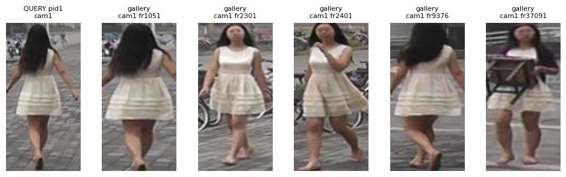
*Figure 1 - Query (left) and gallery crops of the same ID. Note that this particular example is a single-camera sanity check; the evaluation protocol removes same-camera matches.*

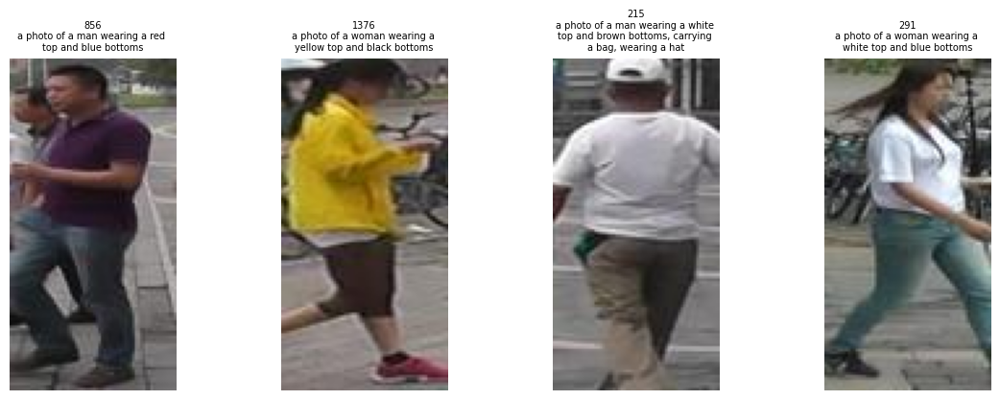
*Figure 2 - Generated sentences against the real crops. Gender, hat and the main colours broadly agree with the images, so the label mapping is not inverted. Annotations are coarse (e.g. the dark purple shirt in the first crop is annotated "red").*

**Image models.**
- *OSNet x1.0*: ImageNet-pretrained, 256×128 input, ID loss (label smoothing 0.1) + batch-hard triplet loss (margin 0.3, L2-normalised features), 16 IDs × 4 images per batch, Adam (lr 3.5e-4, wd 5e-4, 3 warm-up epochs + cosine), flip / pad-crop / random-erasing, mixed precision, 25 epochs.
- *CLIP ViT-B/32* (OpenAI weights via `open_clip`): 224×224 input; only the last 4 transformer blocks, final LayerNorm and projection are trainable (29.1 M trainable parameters) plus a BNNeck + linear ID head; AdamW (2e-5 backbone, 1e-3 head), same losses, 15 epochs. **This is a simplified CLIP-ReID**: the first stage of CLIP-ReID (learning ID-specific text tokens) is *not* implemented.

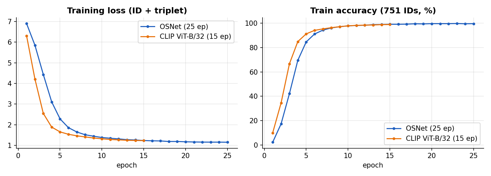
*Figure 3 - Training loss and train accuracy per epoch (parsed from the notebook log). Both models reach ≈ 99% train accuracy.*

**Text branch design decision.** Re-ID fine-tuning moves the CLIP image encoder away from the CLIP text encoder, so text↔image similarity always uses the **original zero-shot CLIP** (both towers), while image↔image similarity uses the **fine-tuned** model. Scores are z-normalised per query before fusion.

**Query degradation (Stage 4).** Each query is evaluated `clean`, `blur` (Gaussian radius 2.5), `low-res` (÷4 then upsampled) and `occlusion` (a random grey patch covering 60%×40% of the crop). The adaptive weight maps the query's Laplacian-variance sharpness (10th-90th percentile of clean queries) to `w ∈ [0.2, 0.9]`.

**Temporal filter (Stage 5).** *Semi-synthetic by construction*: Market-1501 is not a continuous camera network, so I assume cameras are synchronised within a sequence and `time = frame / 25 s`; pairs from different sequences are never filtered. Topology is either assumed (min 3 s for every camera pair) or **estimated from training positives** (1st percentile of Δt = minimum travel time, 99th percentile = maximum window).

**VLM control (Stage 6).** SmolVLM-Instruct (fp16, greedy decoding) receives two crops and the prompt: *"Decide whether they are the SAME person or DIFFERENT people. Start your answer with exactly one word: SAME or DIFFERENT. Then describe the clothing …"*. 50 queries × 3 pair types = 150 calls: **positive** (same ID, different camera), **hard negative** (different ID whose attribute vector is the closest to the query's, often identical), **random negative**.

---

## Results

### RQ1 & RQ2 - Fine-tuning and CLIP vs OSNet

| Model | Rank-1 | Rank-5 | Rank-10 | mAP |
|---|---:|---:|---:|---:|
| OSNet baseline (ImageNet, no Re-ID training) | 14.52 | 26.99 | 34.09 | 4.35 |
| **OSNet fine-tuned (ID + triplet)** | **91.78** | **96.64** | **98.16** | **80.15** |
| CLIP ViT-B/32 zero-shot (image→image) | 7.63 | 15.65 | 21.53 | 1.98 |
| CLIP ViT-B/32 fine-tuned (last 4 blocks) | 83.58 | 94.03 | 96.29 | 66.04 |
| Text-only (zero-shot CLIP, attribute sentence) | 1.69 | 6.62 | 10.90 | 1.27 |

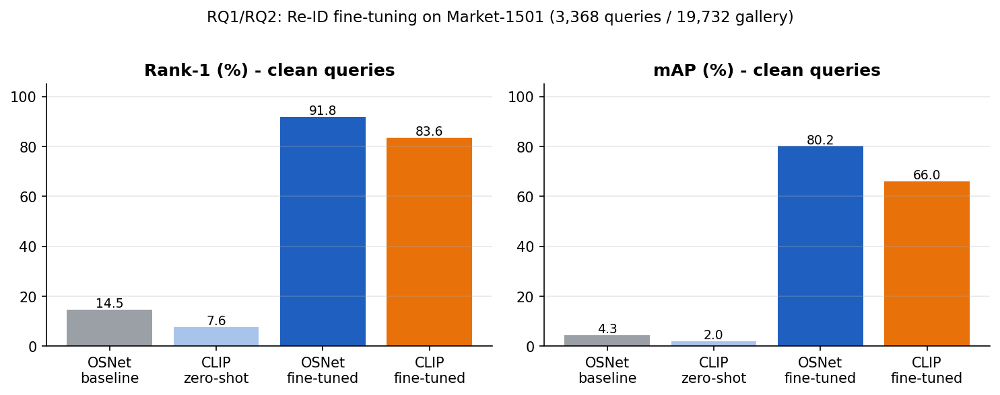
*Figure 4 - Re-ID results on clean queries.*

**RQ1 - answer: yes, by a large margin.** Fine-tuning raises OSNet Rank-1 by +77.3 pp and mAP by +75.8 pp, and CLIP Rank-1 by +76.0 pp and mAP by +64.1 pp. Zero-shot CLIP is even weaker than ImageNet OSNet at identity matching (7.6% vs 14.5% Rank-1): a general-purpose image-text embedding does not, by itself, encode pedestrian identity in small 128×64 crops.

**RQ2 - answer: no, not in this setup.** Fine-tuned OSNet beats fine-tuned CLIP by 8.2 pp Rank-1 and 14.1 pp mAP. Likely contributors (**not ablated**, so treat as hypotheses): only 4 CLIP blocks trained, a short 15-epoch schedule, 128×64 crops squashed to 224×224, no CLIP-ReID prompt-learning stage, and an `open_clip` QuickGELU mismatch warning (see [limitations](#limitations-and-threats-to-validity)). OSNet is the stronger *image* model here.

### RQ3 - Text-only retrieval

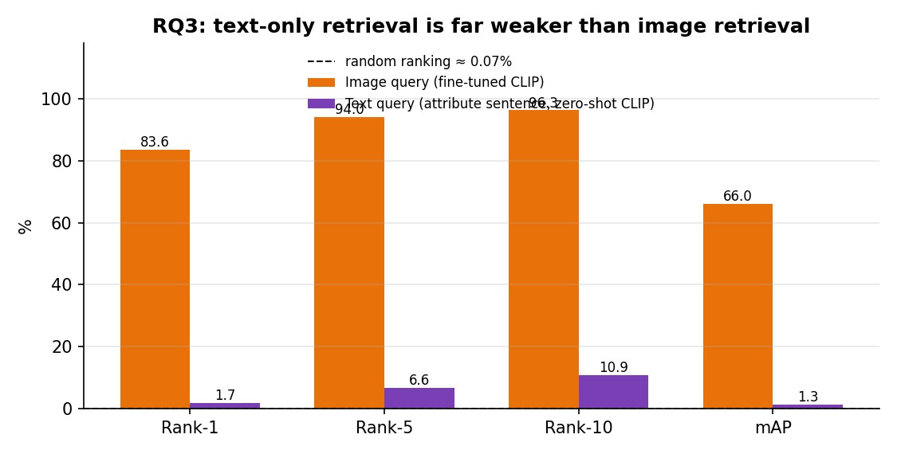
*Figure 5 - Text queries (attribute sentence) vs image queries on the same 3,368 queries and gallery.*

Text-only gets Rank-1 1.69%, Rank-10 10.90%, mAP 1.27%. A random ranking would give about 0.07% (≈ 14.7 true cross-camera matches per query among 19,732 gallery images), so text is clearly informative, but a witness description alone is not enough to find a person in this gallery. The reasons are visible in the data: **different IDs share identical descriptions** (the first hard-negative pair in the control experiment had the *same* sentence for both people), the annotations are ID-level and coarse, and zero-shot CLIP is weak at fine colour/attire grounding on low-resolution crops. This is the honest limitation of the text branch and it propagates to every fusion result below. (The text score does not depend on the query image, so it is identical in all degradation conditions.)

### RQ4 & RQ5 - Fusion and adaptive weighting

Image branch for all fusion/temporal experiments: the **fine-tuned CLIP** model (see limitations). **mAP (%)**:

| Method | clean | blur | low-res | occlusion |
|---|---:|---:|---:|---:|
| image-only | 66.04 | 28.01 | 34.22 | 46.99 |
| text-only | 1.27 | 1.27 | 1.27 | 1.27 |
| fixed w=0.3 | 27.91 | 11.87 | 13.63 | 19.44 |
| fixed w=0.5 | 54.01 | 23.65 | 27.72 | 38.61 |
| fixed w=0.7 | 64.01 | 29.02 | 34.32 | 46.32 |
| adaptive | 53.71 | 6.21 | 6.93 | 40.53 |

**Rank-1 (%)**:

| Method | clean | blur | low-res | occlusion |
|---|---:|---:|---:|---:|
| image-only | 83.58 | 37.86 | 45.99 | 63.30 |
| text-only | 1.69 | 1.69 | 1.69 | 1.69 |
| fixed w=0.3 | 53.38 | 23.63 | 26.63 | 37.14 |
| fixed w=0.5 | 77.17 | 35.93 | 42.16 | 57.19 |
| fixed w=0.7 | 83.43 | 40.94 | 48.22 | 63.03 |
| adaptive | 73.43 | 13.63 | 15.05 | 57.75 |

Difference to image-only, as **ΔmAP / ΔRank-1** (percentage points):

| Method | clean | blur | low-res | occlusion |
|---|---:|---:|---:|---:|
| fixed w=0.5 | -12.03 / -6.41 | -4.36 / -1.93 | -6.50 / -3.83 | -8.38 / -6.11 |
| fixed w=0.7 | -2.03 / -0.15 | +1.01 / +3.08 | +0.10 / +2.23 | -0.67 / -0.27 |
| adaptive | -12.33 / -10.15 | -21.80 / -24.23 | -27.29 / -30.94 | -6.46 / -5.55 |

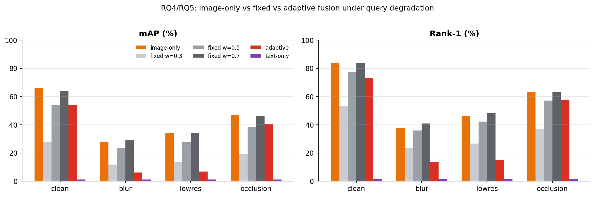
*Figure 6 - Image-only vs text-only vs fixed vs adaptive fusion, per query condition.*

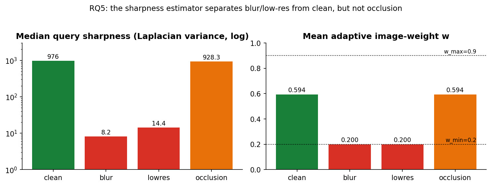
*Figure 7 - The sharpness estimator and the resulting weights.*

**RQ4 - answer: not reliably.** Image-only is the best or within about 2 pp mAP of the best in every condition. Performance rises monotonically with the image weight (0.3 → 0.5 → 0.7) in all four conditions, i.e. the text score adds little complementary information. The only gains are with `w = 0.7` on degraded queries: Rank-1 +3.08 pp (blur) and +2.23 pp (low-res), but mAP only +1.01 / +0.10 pp, while clean (−2.03 mAP) and occlusion (−0.67) get slightly worse. With one run per setting and no confidence intervals, these small gains should not be over-interpreted.

**RQ5 - answer: no, the adaptive weight was harmful.** Adaptive fusion is below image-only by 12.3 pp (clean), 21.8 (blur), 27.3 (low-res) and 6.5 (occlusion) mAP. The estimator itself behaves as designed for blur and low-res (median sharpness 976 → 8.2 / 14.4, so `w` drops to the 0.2 floor), but (i) it does not detect occlusion (928 vs 976, so `w` stays at ≈ 0.59, as I had anticipated), and (ii) the real problem is that a ~1%-mAP text branch cannot compensate when the image weight is lowered. Even on clean queries the mean `w` is 0.594, i.e. ≈ 41% of the weight goes to the weak text score. The adaptive idea may work with a stronger text branch, or with `w_min` set much higher; I did not test that. The weights `w_min = 0.2`, `w_max = 0.9` were not tuned.

### RQ6 - Camera-topology / temporal filter

Tested on the *blur + adaptive fusion* scores (the weakest setting, so the headroom is small):

| Filter | Rank-1 | Rank-5 | Rank-10 | mAP | Pairs removed | True matches removed | % of all true matches | % of removed pairs that were true |
|---|---:|---:|---:|---:|---:|---:|---:|---:|
| no filter | 13.63 | 30.02 | 38.87 | 6.21 | 0 | 0 | 0 | - |
| assumed min = 3 s | 13.54 | 29.87 | 38.75 | 6.15 | 12,705 | 671 | 1.35 | 5.28 |
| estimated min only | 13.57 | 29.96 | 38.81 | 6.17 | 15,094 | 281 | 0.57 | 1.86 |
| estimated min + max window | 13.84 | 30.43 | 39.28 | 6.31 | 1,655,076 | 440 | 0.89 | 0.027 |

(49,649 true cross-camera matches in total; the base rate of a (query, gallery) pair being a true match is 0.075%.)

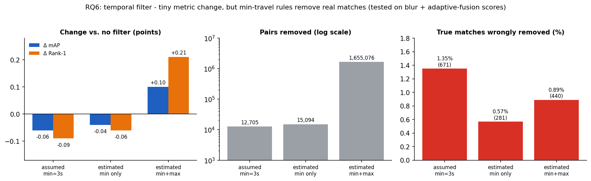
*Figure 8 - Metric change, number of removed pairs and wrongly removed true matches.*

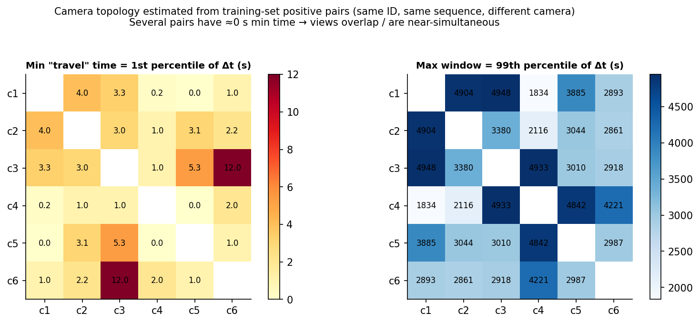
*Figure 9 - Camera topology estimated from training positives: minimum "travel" time (left) and maximum window (right).*

**RQ6 - answer: negligible benefit.** The best variant (min + max) changes mAP by +0.10 and Rank-1 by +0.21 pp; the min-only variants change by −0.04 to −0.09 pp. These differences are far too small to claim an effect. More informative is *what the filter removes*: the pairs removed by min-travel rules are **strongly enriched in true matches** (5.3% and 1.9% of removed pairs versus a 0.075% base rate, roughly 71× and 25×). The estimated topology (Figure 9) shows minimum times of ≈ 0 s for several camera pairs (c1-c5, c4-c5, c1-c4), i.e. the same person often appears almost simultaneously in two cameras in this dataset, so "impossible travel" rules are poorly matched to Market-1501 (a plausible reason is overlapping views; I did not verify this). The max-window rule removes ≈ 2.5% of all pairs but those are overwhelmingly true negatives (0.027% true), which is why it hurts nothing and also helps little: those negatives were already ranked low. Also note that people appear in ≈ 2.03 sequences on average in the training set, and pairs from different sequences are never filtered.

### RQ7 - Camera route

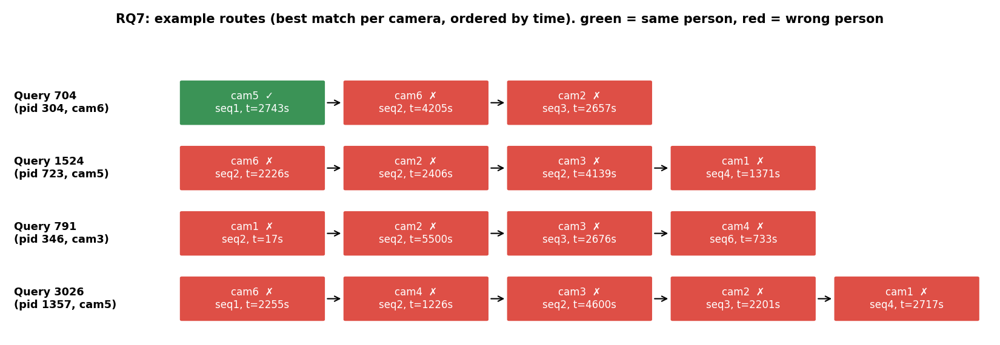
*Figure 10 - Routes built from the top-10 matches (best match per camera, ordered by sequence and frame) for four randomly sampled queries. Green = same person as the query, red = wrong person.*

**RQ7 - answer: the mechanism works, the quality does not (here).** Only 1 of the 16 route steps in these four examples belongs to the query person. The routes were built from the weakest scores (blur + adaptive fusion, Rank-1 ≈ 13.6%), so wrong routes are expected. I did not compute a quantitative route metric, and I did not rebuild the routes from the stronger clean/OSNet ranking; both are listed under future work.

### RQ8 - Does the VLM verify identity?

| Pair type | Correct answer | said SAME | said DIFFERENT | n | % said SAME (95% Wilson CI) |
|---|---|---:|---:|---:|---:|
| Positive (same ID, different camera) | SAME | 0 | 50 | 50 | 0.0 (0.0 - 7.1) |
| Hard negative (closest attributes) | DIFFERENT | 1 | 49 | 50 | 2.0 (0.4 - 10.5) |
| Random negative | DIFFERENT | 0 | 50 | 50 | 0.0 (0.0 - 7.1) |

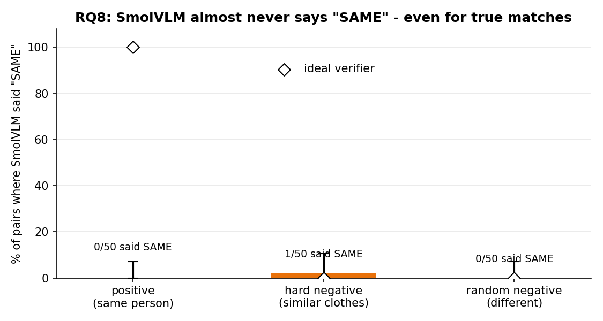
*Figure 11 - Share of pairs for which SmolVLM answered "SAME"; diamonds mark an ideal verifier.*

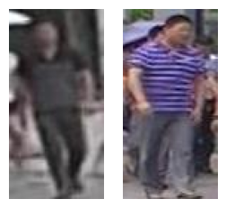
*Figure 12 - The single hard-negative pair judged "SAME" (pid 34 vs pid 1221). The model answered "SAME. Top: purple, bottom: blue, bag: no." although the clothing is visibly different.*

**RQ8 - answer: the hypothesis "the VLM says *same* to everything" is not supported - the model shows a strong *different* bias.** It never recognised a true match (0/50) and its overall accuracy (99/150 = 66.0%) is essentially that of a constant "DIFFERENT" classifier (100/150 = 66.7%). It therefore cannot separate hard negatives from positives (2% vs 0%), so on these low-resolution cross-camera crops it provides no usable identity verification. This is **one model, one prompt, 50 pairs per group**: prompt wording (the prompt asks the model to list non-matching details), upscaled low-resolution crops and camera/lighting changes may all contribute; I did not test other prompts or larger VLMs. Hard negatives are defined by coarse attribute equality, so they are not always visually similar (Figure 12).

### RQ9 - Are the VLM explanations faithful?

| Check (80 random gallery images) | Accuracy |
|---|---:|
| Top colour mentioned correctly | 76.7% |
| Bottom colour mentioned correctly | 64.3% |
| Backpack present/absent correct | 83.8% |

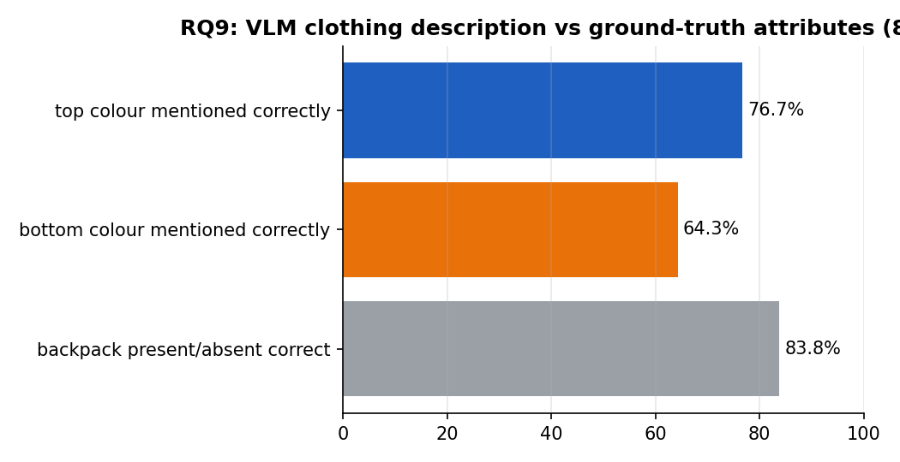
*Figure 13 - Keyword match between the VLM's one-sentence description and the ground-truth attributes.*

**RQ9 - answer: partly.** The VLM names the annotated top colour in about three quarters of cases and the bottom colour in about two thirds. Caveats: the check is simple keyword matching (any annotated colour counts), colour accuracies are computed over images with at least one annotated colour, and the backpack figure must be read against the majority-class baseline (the no-backpack class may dominate), which I did not compute. Combined with RQ8, the VLM's *descriptions* are somewhat grounded, but its *same/different verdict* is not.

### Demo (Stage 7)

A Gradio demo (text and/or image query → top-10 matches, route, VLM explanation) was written for the project, but it is **not part of the executed notebook and none of the reported results depend on it**; no demo screenshot is shown here.

<!-- After running the demo cell, save a screenshot as results/14_gradio_demo.png and uncomment:

-->

---

## Limitations and threats to validity

1. **Weaker image branch used for Stage 4-5.** The fusion, temporal and route experiments use the fine-tuned **CLIP** image features, although fine-tuned **OSNet** was clearly better in Stage 2 (Rank-1 91.8 vs 83.6). Absolute numbers in RQ4-RQ7 are therefore lower than they could be, and conclusions about the filter and routes were drawn on the weakest score matrix (blur + adaptive).
2. **Possible CLIP configuration issue.** `open_clip` printed a QuickGELU mismatch warning (model config `ViT-B-32` with the OpenAI weights, which were trained with QuickGELU). This may have degraded the pretrained CLIP features, which would affect zero-shot CLIP, the text-only branch and the CLIP fine-tuning. I did not re-run with the `ViT-B-32-quickgelu` config, so the size of this effect is unknown.
3. **Weak text branch.** ID-level, coarse attributes; many IDs share a description; text-only retrieval is 1.3% mAP. Fusion conclusions are conditional on this.
4. **Simplified CLIP-ReID.** No prompt-learning stage; last 4 blocks only; short schedule.
5. **Hyper-parameters not validated.** `w_min`, `w_max`, the fixed weights and the degradation strengths were chosen by hand and evaluated on the test set; no separate validation split.
6. **Single run, no confidence intervals** for retrieval metrics (VLM proportions do have Wilson intervals). Differences of a few tenths of a point are not evidence of an effect.
7. **Semi-synthetic camera network.** Time is `frame/25` s within a sequence; there are no real timestamps or travel times. Cross-sequence pairs are not filtered.
8. **Route evaluation is qualitative** (four examples, no metric).
9. **VLM study is small and narrow:** one model, one prompt, 50 pairs per group, greedy decoding; the explanation check uses keyword matching.
10. **Degradations are synthetic** and applied to queries only.

## Future work

- Re-run Stage 4-5 with the **OSNet** image branch and on clean queries; add a route metric (e.g. fraction of correct camera steps).
- Fix the QuickGELU configuration and re-evaluate CLIP, zero-shot text retrieval and fusion.
- Implement CLIP-ReID's prompt-learning stage; train more blocks / longer; keep the 2:1 aspect ratio with interpolated position embeddings.
- Strengthen the text branch (fine-tune CLIP's text side on attributes or use a text-based person-search model), then revisit adaptive fusion; tune `w` on a validation split.
- Alternative quality estimators for occlusion; learn the weight instead of using a hand-made mapping.
- VLM: test other prompts (e.g. attribute comparison first, verdict last), larger VLMs, and balanced positive/negative sampling with more pairs.

---

## Related work

- **Person re-identification & training recipes:** OSNet (Zhou et al., ICCV 2019); Bag of Tricks and Strong Baseline for Deep Person Re-identification (Luo et al., CVPR Workshops 2019); Torchreid (Zhou & Xiang, 2019).
- **Vision-language models for Re-ID:** CLIP (Radford et al., ICML 2021); CLIP-ReID (Li et al., AAAI 2023).
- **Text-based person search:** Person Search with Natural Language Description (Li et al., CVPR 2017) and later CLIP-based text-image Re-ID work. This project does **not** claim a new text-based Re-ID model; its contribution is the *combination* of fusion, a time-consistency filter and a **control experiment on VLM explanations**.
- **Data:** Market-1501 (Zheng et al., ICCV 2015); Market-1501 attribute annotations (Lin et al., Pattern Recognition 2019).
- **VLM:** SmolVLM (Hugging Face, 2025).

*Please double-check bibliographic details before submitting a formal report.*

## Ethics and data license

- Research and education only. Do not use this system to identify or track real individuals.
- The dataset is **not** redistributed in this repository. I obtained Market-1501 through a Kaggle mirror whose listing shows the license as "unknown"; please obtain the data from the original authors and follow their terms. The attribute annotations are by Lin et al. and have their own terms.
- Pretrained models (ImageNet-pretrained OSNet via Torchreid, OpenAI CLIP via `open_clip`, SmolVLM) keep their own licenses.

## Acknowledgements

Thanks to the authors of Market-1501, Torchreid/OSNet, OpenCLIP and SmolVLM, and to my supervisor for the research direction.
